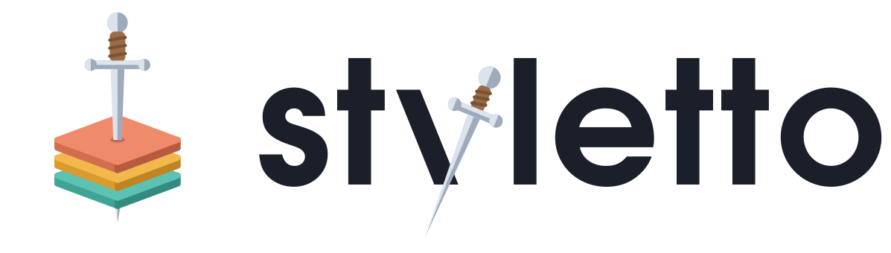

<p align="center">
  <picture>
    <source media="(prefers-color-scheme: dark)" srcset="assets/wordmark-dark.svg">
    
  </picture>
</p>

# styletto

A design system for [Guido](https://github.com/MalpenZibo/guido): tokens,
themes and components. Every piece of it is on show in the
[storybook](storybook).

## Principles

- Every length, corner, icon and type size is a step on a scale, and every
  colour a name in the palette. Components hold no numbers of their own.
- What a surface chose (palette, density, shape, fonts, material, motion)
  is its `Ui`, declared once and read where the tree is built.
- Components are `#[component]`s: closed, set through their props, slots
  and callbacks. Primitives stay plain functions returning a container, so
  an app can add to them: `icon`, the text styles, `centered_row`,
  `pressable`, `island`.

## Layout

| Module | Holds |
|---|---|
| `foundations` | `tokens`, `typography`, `control`, `motion`, `icons`: the scales, the motion and the icons |
| `theme` | `palette`, `presets`, `material`, `config`: colours by meaning, the preset themes, themes from a colour, the `[appearance]` table |
| `primitives` | `text`, `layout`, `island`, `satellite`: plain functions an app can add to |
| `components` | the components, below |

`Icon`, `icon`, `centered_row`, `Ui`, `provide_ui` and `ui` are also at the
root. Below, a path such as `tokens::size` is short for
`foundations::tokens::size`.

## Use

```toml
[dependencies]
styletto = { git = "https://github.com/MalpenZibo/styletto", features = ["serde", "wallpaper"] }
```

```rust
use styletto::{Icon, provide_ui, ui};
use styletto::components::list::row;
use styletto::components::toggle::toggle;

provide_ui(config.appearance.ui(system_dark)); // or Ui::default()

row("Wi-Fi")
    .icon(Icon::Wifi)
    .subtitle("Home 5G")
    .trailing(toggle(true))
```

| Feature | Adds |
|---|---|
| `serde` | `theme::config::UiConfig`, read from an `[appearance]` table |
| `material` | themes worked out from a seed colour |
| `wallpaper` | themes worked out from an image (implies `material`) |

## The Ui

`provide_ui(Ui)` declares it for a subtree and `ui()` reads it. Each choice
moves the scales rather than setting numbers:

| Choice | Values | What it does |
|---|---|---|
| `Density` | `Compact`, `Default`, `Comfortable` | moves type, controls, icons, tiles and space up to `S8` one step |
| `Shape` | `Square`, `Soft`, `Round` | moves every radius one step; a pill stays a pill |
| `Material` | `Solid`, `Translucent`, `Glass` | the island's opacity (1, 0.86, 0.75) and blur (0, 24, 48); the text on it darkens or lightens as far as it must to read with the island's opposite behind |
| `Motion` | `Full`, `Reduced`, `None` | springs, fades only, or instant changes |
| `Fonts` | `sans`, `mono` | the families, the system's by default |

## Tokens

A step reads its value with `.px()` in the current `Ui`.

| Scale | Steps | px |
|---|---|---|
| `tokens::size` | `S0` `S0_5` `S1` `S2` `S3` `S4` `S6` `S8` `S10` `S15` `S20` `S30` `S40` `S60` `S80` `S100` | 0 2 4 8 12 16 24 32 40 60 80 120 160 240 320 400 |
| `tokens::radius` | `NONE` `XSMALL` `SMALL` `MEDIUM` `LARGE` `XLARGE` | 0 4 8 16 32 64 |
| `tokens::icon` | `XSMALL` `SMALL` `MEDIUM` `LARGE` `XLARGE` | 12 16 20 24 32 |
| `tokens::tile` | `XSMALL` `SMALL` `MEDIUM` `LARGE` `XLARGE` `XXLARGE` | 16 24 32 40 48 64 |

Up to `S8` a size step is space and follows the density; past it, it is a
layout length and stays. A length an app lays out with, a panel's width or
a list's height before it scrolls, follows the density through
`size::scaled(length)`: ×0.875 compact, ×1.25 comfortable
(`Density::scale`), about as much as what a panel holds grows, so it keeps
its proportions. A tile step also sets its corners, the icon on it
and the letter of an initial; an icon step sets the stroke of a ring.

Corners: a box is a squircle (`radius::shape`, or `Radius::corners`), a pill
or a circle is round (`radius::pill(height)`). A box around another takes
`radius::around(inner, padding)`, so the curves stay concentric.

Fixed values: `stroke::HAIRLINE` 1, `RING` 1.5, `BOLD` 2, `HEAVY` 3;
`opacity::DISABLED` 0.4, `RING` 0.7 (a field's ring in the accent);
`glow::SMALL` 4, `MEDIUM` 8; `scrollbar::WIDTH` 4, `HOVER_WIDTH` 8,
`MARGIN` 2, `MIN_HANDLE` 24, the same in every density.

A hue tints what it fills or lights at a `tint` step, the alpha of its fill
over the island: `SUBTLE` 0.12 a card's wash while it warns or does well,
`MEDIUM` 0.15 a card's while it alerts and a glow, `STRONG` 0.2 behind a
small mark's ink (a tag, an alert's tile). What sits on a tint is drawn in
the hue as text.

## Type

Six categories in four sizes, `LARGE` to `XSMALL` (`typography::TITLE_SMALL`
and so on). Sizes are even and line heights multiples of 4; the density may
move a size within its category.

| Category | Use | Sizes / line heights |
|---|---|---|
| `DISPLAY` | big numbers: a clock, a level | 48/48 40/40 32/32 24/24 |
| `TITLE` | a page's or a group's title | 24/28 20/24 16/20 14/20 |
| `LABEL` | one line of a control | 16/20 14/16 12/16 10/12 |
| `BODY` | running text | 16/24 14/20 12/16 10/16 |
| `MICRO` | uppercase, tracked: section names | as `LABEL` |
| `MONO` | code, logs | as `LABEL` |

`.em()` is the semibold weight, `.tabular()` keeps figures one width.
`.typeset(kind)` applies a type to a text or an input; a `Resolved` style
off the scale works too. `text::{label, caption, heading, overline, figure}`
are the common ones, already coloured.

## Controls

`control::Size` is the height of a control and what follows from it:

| Size | `Xxs` | `Xs` | `Sm` | `Md` | `Lg` | `Xl` |
|---|---|---|---|---|---|---|
| Height | 20 | 24 | 28 | 36 | 40 | 48 |

`icon()`, `inline()` (the padding from a pill's ends), `gap()` and
`label()` give the rest, already moved for the density.

## Colours

A theme sets a `Scheme`: `background`, `text`, `sub`, `dim`, and four hues
(`accent`, `success`, `warning`, `danger`), each a `SchemeHue`: its fill
`color`, the colour that reads `on` it and its `text`. An on-colour left
unset is worked out to reach a 4.5:1 contrast. `Scheme::named()` lists its
colours by the names of the config file (`background`, `on_accent`,
`accent_text`, ...) and `Scheme::with(name, colour)` sets one by that name.

Components read the `Palette` derived from it: `island`, `surface`,
`surface2`, `line`, `text`, `sub`, `dim`, the four hues `accent`, `success`,
`warning` and `danger`, and `ripple`. Each hue is a `HueColors`: its `fill`,
the colour `on` it and its `text`; `palette.hue(Hue::Danger)` reads one by
its `Hue` (`Scheme::fill(hue)` its theme's colours), `Hue::ALL` lists the
four and `hue.name()` names one. `palette.ink(hue)` is the hue as text, or
`text` without one (`None`), what a component toned or left neutral writes
in.

A hue's `fill` is what paints a surface, a bar, a ring or a border; `on` is
the text on that fill; `text` is the hue as text or an icon on the island,
`surface` and `surface2`, at 4.5:1 on all three (3:1 on a see-through
island, below).
Unless the theme or the config sets one,
it is the fill moved in lightness only, in Oklab, with its hue and chroma
kept (as far as sRGB holds them), just as far as it must to read: a fill
that already reads is its own text, and a pale one turns deeper, not grey.

`text` is body text and `sub` secondary text (captions, placeholders, small
labels): both reach 4.5:1 on the island and on `surface` and `surface2`.
`dim` is for icons, dividers and large text, never small text, and reaches
3:1. A preset takes these from the theme's own colours for text, not from
its borders or overlays; where none reads well enough, `Scheme::readable`
mixes the nearest toward `text` until it does, and does the same for a theme
from a seed. Colours set in `[appearance.dark]` and `[appearance.light]` are
used as given, and the text they leave to the source is made to read again
on a `background` set there; a hue's text left to the source follows its
fill.

On a see-through island the text is adjusted again: `Ui::colors` holds it
as dark or as light as it must be to read with the island's opposite showing
through, black behind a light island or white behind a dark one. Each hue's
`text` is moved the same way, in lightness only, but to 3:1, the floor
`dim` has (WCAG's for icons and large text), not 4.5:1: with white behind
dark glass, a hue that reads at 4.5:1 is so light it is all but white, as
light as the text, and a warning no longer looks like one. Where not even
black or white would read, the island is drawn denser. A colour set below
its floor keeps the contrast it was set with. Paint text with `ui().colors`, not with a
`Scheme`'s or a theme's own colours, or it won't follow.

The preset themes, in `presets::THEMES`, each with dark and light flavours
and its own accents: Tokyo Night, Catppuccin, Nord, Gruvbox, Dracula, Rosé
Pine, Everforest, Kanagawa, one file each in `src/theme/presets/`.
`material::schemes(seed, variant, contrast)` makes both sides from one
colour with Material Color Utilities.

## Appearance config

With the `serde` feature, `UiConfig` reads this table and `ui(system_dark)`
resolves it. Names match in any case; a wrong one is logged and left out.

```toml
[appearance]
# One source of colours: a theme...
theme = "catppuccin"
dark_flavor = "mocha"
light_flavor = "latte"
accent = "mauve"
# ...or a seed colour...
# seed = "#6750a4"
# ...or a wallpaper (it wins over a seed, which wins over a theme).
# wallpaper = "~/Pictures/wallpaper.jpg"
variant = "tonal-spot"   # for a seed or a wallpaper: vibrant, expressive, content, ...
contrast = "standard"    # medium, high

mode = "auto"            # light, dark, or as the system prefers
density = "default"      # compact, comfortable
shape = "soft"           # square, round
material = "translucent" # solid, glass
motion = "full"          # reduced, none

[appearance.fonts]
sans = "Inter"
mono = "JetBrains Mono"

# Any colour of either side, by its Scheme::named() name, set over the source.
# A hue's are its name, on_ before it and _text after it: danger, on_danger,
# danger_text.
[appearance.dark]
accent = "#ff79c6"
on_accent = "#1a1b26"
accent_text = "#ff92d0" # the accent as text; worked out from accent if unset

[appearance.light]
background = "#fdf6e3"
```

## Motion

`motion::spring()` is the island's spring for every fold and growth,
`tactile()` the quicker one of a press, `hover()` and `color()` eased
changes, `easing(ms)` and `springing(config)` custom ones. All follow the
`Motion` of the `Ui`. `toggling(rest, hovered)` moves a fill that turns on
and off, as a toggling button's or a tile's: a hover at `hover()`, a change
of state at `color()`, told apart by the fill it leaves. `fading(enter, leave)` gives a value one transition
for a view coming in and another for it going out. `arriving` cross-fades a
view in, `entering` opens a panel, `shake()` plays a refusal and `armed()`
ignores presses just after a view appears.

A press (`pressable`) shrinks what it presses to one of three steps: a
button or a small tile to `PRESS_SCALE` (0.95); a wide surface, as a wide
tile, to `PRESS_SCALE_WIDE` (0.97), less, as a little already moves its ends
a long way; a small target, as the icon box in a wide tile, to
`PRESS_SCALE_INNER` (0.9), more, so its press shows.

## The island

`island::island` is one shape springing around whatever view it shows. Its
look comes in pieces, for every shape that should match it: `paint` fills
and blurs it as the material asks, `border` rims it, `shadow(glow)` is what
it casts, and `edge` is the border and the shadow together. With a solid
material `paint` still declares the shape to the compositor, so a
compositor rule that blurs a surface with no blur of its own (niri's
`layer-rule` `blur`) leaves the space around it alone. Merging an island
with what comes out of it, the holder takes the edge,
`edge(holder.merge_children(reach))`, what comes out takes the paint, and
the island leaves its shadow to the holder with `.shadow(Shadows::none())`.
A `satellite` is such a shape: it splits off the end of its host and merges
back.

## Icons

[Lucide](https://lucide.dev) icons, the unmodified SVG files of
`lucide-static` 1.61.0 in [`icons/`](icons), under Lucide's licence. To add
one, copy its file there and add a line to the `icons!` table in
`src/foundations/icons.rs`. The module also draws spinners, initials,
pictures and artwork; the island and its satellites are in `primitives`.

## Components

The modules of `components`:

| Module | What |
|---|---|
| `button` | buttons, with a label, an icon or both, an action or a toggle as a tile is; the bar's pills; `pressable` |
| `toggle`, `slider`, `input` | a switch, a slider and a slider row (to 100%, or past it to a max; a wheel notch moves it by a step, 5% unless set), text and password fields |
| `list` | rows (a checked one marks the choice in use; one in a tag's `Tone`, as warning or danger, has its title, icon, hover and press in that hue), sections, empty states, page headers with a subtitle, pages that slide, a list that scrolls past a height with the theme's scrollbar |
| `tile` | quick-settings tiles, wide and small; a wide one's subtitle takes a second line when it needs one, and tiles side by side in a `Flex::row()` are as tall as the tallest |
| `tag` | read-only pills for a state, tinted by a `Tone` (neutral, accent, success, warning, danger), glowing if asked |
| `badge` | dots, icon tiles |
| `level` | `Level`, how a value stands, and its ink; the level indicator: the icon a value picks from a set, its percentage beside it if asked |
| `card` | level figures and stat cards coloured by their `Level` |
| `progress`, `sparkline`, `roll` | bars, rings, recent samples, rolling digits |
| `notification` | notifications, alone and grouped |

A button is one component, with a label, an icon before it, or the icon
alone in a circle (`button().icon(icon)` with no label).
Its `Variant` (`Neutral`, `Accent`, `Danger`) sets its colour and its `Fill`
how it rests: `Solid` in the variant's fill (`surface` for a neutral one)
with the ink on it, `Ghost` clear until hovered, its ink the hue as text.
An action takes `on_click`. A toggle takes `active` and `on_toggle`: while
`active` it is on, as a tile: filled with the accent, its ink `accent.on`,
whatever its variant and fill; a toggle is a neutral or ghost button (a
solid accent one is filled with the accent already, and looks the same on
and off). Given both, a press calls `on_click`, then `on_toggle`. Hovered,
a neutral fill steps to the next surface and a hue brightens; disabled, on
or off, it fades and takes no press.

Whatever turns on and off (a toggling button, a tile, a small tile, the
switch) is controlled, as GTK's toggle button: the app passes `active`, a
press calls `on_toggle` with the opposite, and the app stores what it
keeps, or not. `ui::active_fill(active, off)` and `active_ink(active, off)`
are its fill and its ink: the accent and `accent.on` while on, `off` while
not. A bar's `pill` is not a toggle: its `active` marks the one chosen (a
workspace shown) and a press calls `on_click`, as a list row's `selected`.

A tag shows and takes no press. Its `Tone` tints it at `tint::STRONG`
(`surface` while neutral), and `Tone::ink()` is the colour for what it
holds: `text` while neutral, else the hue as text. `Tone::hue()` is its
`Hue`, none while neutral; a list row takes the same `Tone`. With `glow` a toned tag
lights around it, as the island's privacy tag does.

```rust
use styletto::components::button::{Fill, Variant, button};
use styletto::components::tag::{Tone, tag};

button().label("Auto").active(auto).on_toggle(move |on| auto.set(on));
button().label("Forget").variant(Variant::Danger);
button().icon(Icon::X).fill(Fill::Ghost).size(Size::Sm);
tag().tone(Tone::Warning).glow(true).child(icon(Icon::Mic, size, Tone::Warning.ink()));
```

The app decides a level, with its own thresholds, and styletto draws it:
`Level::of(value, warn, alert)` when high is bad, `Level::below(value, warn,
alert)` when low is, and `Level::Good` for better than normal, a battery
charging. `Level::hue()` is its `Hue`: success, warning or danger, none
while normal. `level_ink` is `text` while normal, else that hue's `text`; a
card's tint and glow take its `fill`.

The indicator's sets of icons are data, each icon from the value it starts
at: `Levels::BATTERY` rounds its bars up, a bar staying while there is
charge in its third: empty below 15%, one bar from 15%, two past a third,
three past two thirds, so one bar and the empty one fall where a battery is
a warning and an alert; `Levels::WIFI` takes the nearest number of arcs,
none below 17%, then one, two and three from 17, 50 and 83%; `Levels::VOLUME` has no waves below 1%, one from 1% and two from 50%. A
state off the scale takes its own icon in place of the set's:

```rust
use styletto::Icon;
use styletto::components::level::{Level, Levels, level_indicator};

level_indicator(Levels::BATTERY, 12.0).level(Level::below(12.0, 30.0, 15.0)).percent(true);
level_indicator(Levels::BATTERY, 50.0).icon(Icon::BatteryCharging).level(Level::Good);
level_indicator(Levels::VOLUME, 0.0).icon(Icon::VolumeOff);
level_indicator(Levels::WIFI, 70.0);
```

## Licence

MIT, see [LICENSE](LICENSE). The icons in [`icons/`](icons) are Lucide's,
under its own licence: see [`icons/LICENSE`](icons/LICENSE).
